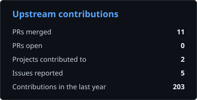
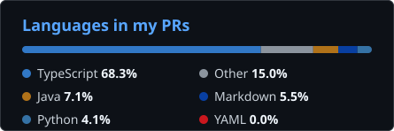

<!-- Generated from README.template.md by scripts/update_readme.py. Edit the template, not this file. -->

# Vaidik Garg

Student developer · Java server work &amp; full-stack web

I'm a student who builds full-stack web projects and sends fixes to open source projects. **11 merged upstream PRs** so far, in Apache HugeGraph and Apache Fineract.

On [Apache HugeGraph](https://github.com/apache/hugegraph) I work on the Store module's query iterators: hashing `BackendColumn` by its bytes so union and intersection match identical rows, keeping limit-dedup keys intact through id-only projections, holding on to pending rows in the dedup iterators across query batches, and closing `MultiListIterator`'s sub-iterators when a query is cancelled early or a close fails. I reported most of these bugs as issues before fixing them.

On the [Apache Fineract back-office UI](https://github.com/apache/fineract-backoffice-ui) (Angular) I build and fix admin screens: editing scheduler jobs, configuring the SMS gateway, approving share dividends, and getting dates right in client records and the birth-date picker.

Outside upstream work I'm building [Study Vault](https://github.com/vaidikgarg-bit/study-vault), a course notes hub with generated quizzes and flashcards, on FastAPI and SQLite with a Tailwind front end.

## Upstream work

| Project | PRs | Focus |
| --- | --- | --- |
| [Apache HugeGraph](https://github.com/pulls?q=is%3Apr+author%3Avaidikgarg-bit+repo%3Aapache%2Fhugegraph+repo%3Aapache%2Fhugegraph-doc) | 6 merged · 0 open | Store module fixes: row hashing and dedup in scan iterators, id-only projections, MultiListIterator cleanup, and the tests around them. Latest: <a href="https://github.com/apache/hugegraph/pull/3445">#3445</a> — fix(store): harden MultiListIterator close and next |
| [Apache Fineract back-office UI](https://github.com/pulls?q=is%3Apr+author%3Avaidikgarg-bit+repo%3Aapache%2Ffineract-backoffice-ui) | 5 merged · 1 open | Angular screens: client dates, scheduler job editing, SMS gateway setup, share dividend approval. Latest: <a href="https://github.com/apache/fineract-backoffice-ui/pull/867">#867</a> — feat(audit): open audit entries and filter the trail on the server |

## Open PRs

Open pull requests in upstream projects (refreshed automatically).

- [apache/fineract-backoffice-ui#867](https://github.com/apache/fineract-backoffice-ui/pull/867) — feat(audit): open audit entries and filter the trail on the server

## Stats

  
  

## Tools

Java · Python · TypeScript · JavaScript · Angular · FastAPI · SQLite · RocksDB · Tailwind CSS · HTML/CSS · GitHub Actions · Git

---

Auto-updated 2026-11-04 · [workflow](.github/workflows/update-readme.yml)
